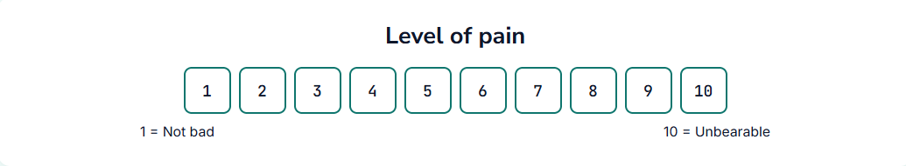
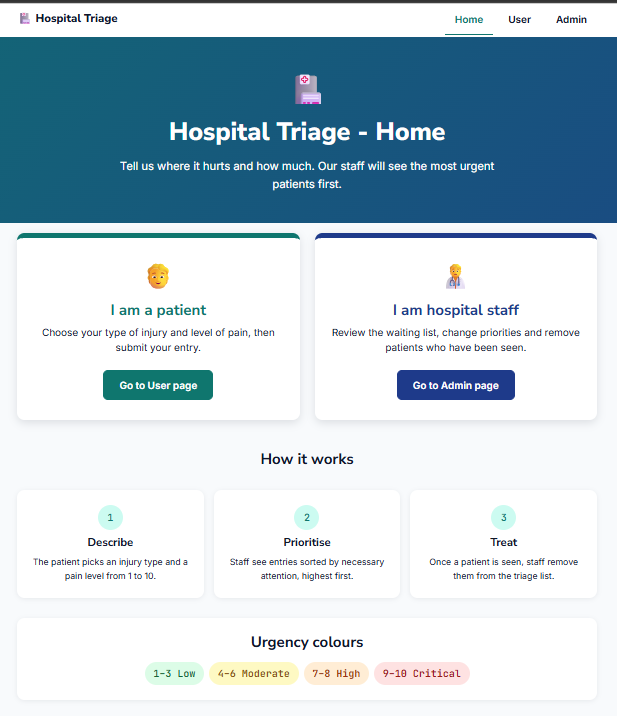
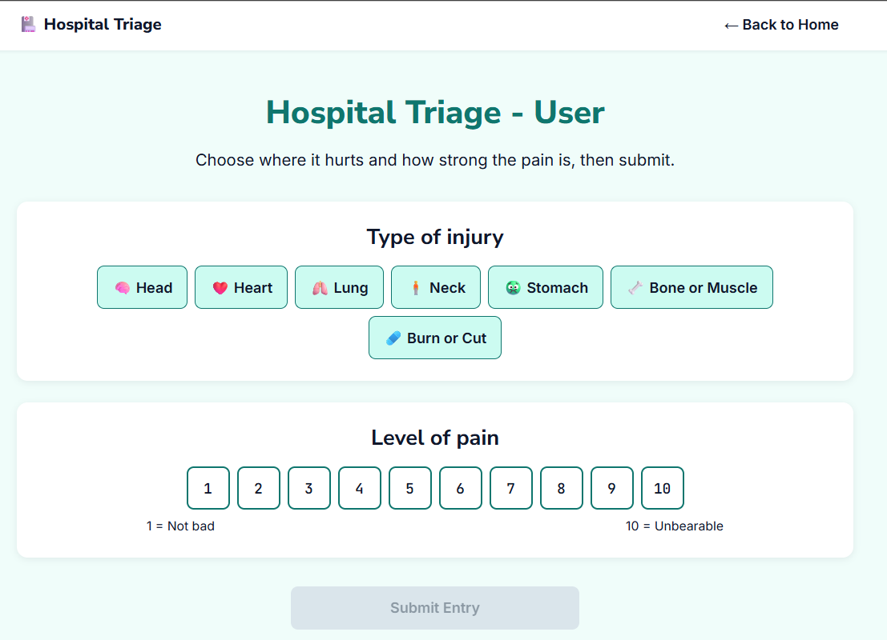
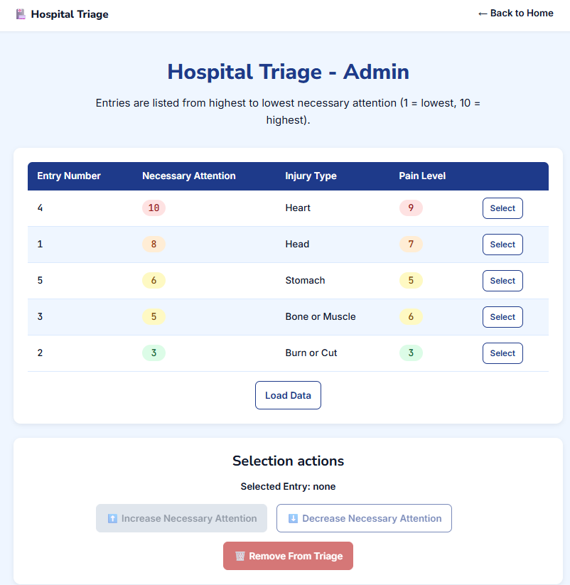

# Hospital Triage - Design System 
A single markdown file for how the Hospital Triage app **looks**. **feels** and **behaves**
The app has two audiences: **patients** (User page) and **hospital staff** (Admin page). Each gets its own visual identity, but are built from the same shared rules.

## 1. Overview
| | Home Page | User Page | Admin Page |
|---|---|---|---|
| **Who uses it** | Everyone | Patients arriving at the emergency room | Triage nurses / hospital staff |
| **Main goal** | Explain the app and send people to the right page | Describe the injury and pain level quickly | Review, prioritise and manage the waiting list |
| **Mood** | Welcoming, clear | Calm, reassuring, simple | Focused, efficient, information-dense |
| **Page title** | `Hospital Triage - Home` | `Hospital Triage - Patient` | `Hospital Triage - Hospital staff` |

### How the app works 

On the **Patient** side they open the User page, select their injury type, select their pain level (1-10) and then presses the submit entry and it is placed into the triage list 

On the **Staff** side they open the Admin page, presses load data, reviews the list and sees the highest attention first on the list, then if neccessary they can increase or decrease attention

Once the patient has been seen they remove it from the Triage list


## 2. Fonts

### 2.1 Font families

| Role | Font | Fallback stack | Used for |
| **Headings** | **Nunito Sans** | `"Nunito Sans", "Segoe UI", sans-serif` | Page titles, section titles |
| **Body** | **Inter** | `"Inter", Arial, sans-serif` | Descriptions, labels, buttons, inputs |
| **Data** | **JetBrains Mono** | `"JetBrains Mono", Consolas, monospace` | Entry numbers, pain levels, attention scores |

Import (Google Fonts):
```css
@import url("https://fonts.googleapis.com/css2?family=Inter:wght@400;500;600&family=JetBrains+Mono:wght@500&family=Nunito+Sans:wght@400;700;800&display=swap");
```

### 2.2 Font Weights

| Weight | Value | Where it is used |
|:---:|:---:|---|
| Regular | `400` | Descriptions and body text |
| Medium | `500`| Labels, table cell data |
| Semi bold | `600`| Buttons, table headers |
| Bold | `700`| Section headings |
| Extra bold | `800`| Main page title |

### 2.3 Type scale

| Element | Size | Weight | Line height |
|---|:---:|:---:|:---:|
| Page title (`h1`) | `2.25rem` (36px) | 800 | 1.2 |
| Section heading (`h2`) | `1.5rem` (24px) | 700 | 1.3 |
| Description text | `1.125rem` (18px) | 400 | 1.6 |
| Button / label | `1rem` (16px) | 600 | 1.4 |
| Table data | `1rem` (16px) | 500 | 1.4 |
| Helper text | `0.875rem` (14px) | 400 | 1.5 |

### 2.4 Why these fonts?

- **Nunito Sans** has rounded, friendly letterforms, which helps a stressed patient feel at ease, while the heavy weights make titles unmissible.
- **Inter** was designed for screens. It stays crisp at small sizes and has very clear characters, so `1` / `l` / `I` are never confused in a medical context
- **JetBrains Mono** gives every digit the same width, so numbers line up perfectly in the admin table and are easy to scan and compare
- All three are free, widely supported and fall back to safe system fonts if they fail to load

## 3. Colour Palette

### 3.1 User page palette: *"Calm Care"*

| Name | Hex | Role |
|---|:---:|---|
| Teal 700 | `#0F766E` | Titles, primary buttons, selected state |
| Teal 500 | `#14B8A6` | Hover state, focus ring |
| Teal 100 | `#CCFBF1` | Option button background |
| Mint White | `#F0FDFA` | Page background |
| Ink | `#0F172A` | Body text |

**Why:** teal and mint are associated with healthcare, calm and cleanliness. A patient in pain should not face alarming reds, so the Patient page stays soft and reassuring.

### 3.2 Admin page palette: *"Command Desk"*

| Name | Hex | Role |
|---|:---:|---|
| Navy 900 | `#1E3A8A` | Titles, table header, primary buttons |
| Blue 500 | `#3B82F6` | Hover state, focus ring |
| Amber 500 | `#F59E0B` | Highlight for the selected row |
| Ice Blue | `#EFF6FF` | Page background, zebra table rows |
| Ink | `#0F172A` | Body text |

| Swatch | Name | Hex | Role |
|---|:---:|---|
| Teal 700 | `#0F766E` | Start of the hero gradient, patient card |
| Navy 900 | `#1E3A8A` | End of the hero gradient, staff card |
|| Cloud | `#F8FAFC` | Page background |
| White | `#FFFFFF` | Cards, navigation bar |
 
**Why:** the Home page is the bridge between the two worlds. Its hero banner blends the teal of the User page into the navy of the Admin page, and each role card repeats the colour of the page it leads to. People learn the colour link before they even click.

### 3.3 Shared urgency colours

Used on both pages so the meaning of the colour never changes 

| Level | Pain / Attention | Background | Text |
| Low | 1 - 3 | `#DCFCE7` | `#166534` |
| Moderate | 4 - 6 | `#FEF9C3` | `#854D0E` |
| High | 7 - 8 | `#FFEDD5` | `#9A3412` |
| Critical | 9 - 10 | `#FEE2E2` | `#991B1B` |

**Why:** the traffic light scale is universally understood. Each level uses a *light tint with dark text* instead of a bright fill, which keeps text readable. A level is **never** shown by colour alone: it is always accompanied by a label or number

### 3.4 CSS variables 

```css
:root {
  /* User page */
  --user-primary: #0F766E;
  --user-hover:   #14B8A6;
  --user-tint:    #CCFBF1;
  --user-bg:      #F0FDFA;
 
  /* Admin page */
  --admin-primary: #1E3A8A;
  --admin-hover:   #3B82F6;
  --admin-select:  #F59E0B;
  --admin-bg:      #EFF6FF;
 
  /* Shared */
  --ink: #0F172A;
  --urgency-low:      #DCFCE7;
  --urgency-moderate: #FEF9C3;
  --urgency-high:     #FFEDD5;
  --urgency-critical: #FEE2E2;
}
```
## 4. App Components

### 4.1 Component summary 

| Component | Page | Purpose | Key design choice |
|---|:---:|---|---|
| Navigation bar | All | Move between pages | White bar, current page underlined |
| Hero banner | Home | Welcome and explain | Teal-to-navy gradient, white text |
| Role cards | Home | Send people to the right page | Two cards, colour matches the target page |
| How-it-works steps | Home | Explain the process in 3 steps | Numbered cards |
| Page title | Both | Identify the page | Large, centred, accent colour |
| Description | Both | Explain what to do | Short sentence directly under the title |
| Injury option buttons |  User | Choose the type of injury | Large "chip" buttons with an icon |
| Pain level scale | User | Rate pain 1 – 10 | One row of 10 numbered buttons |
| Submit button | User | Send the entry | Full-width primary button |
| Triage table | Admin | List all entries by priority | Sorted, zebra rows, urgency badges |
| Load data button | Admin | Refresh the list | Secondary button above the table |
| Selection actions | Admin | Manage the selected entry | Button group with colour-coded actions |

### 4.2 Navigation bar *(all pages)*
 
| Property | Value |
|---|---|
| Layout | Brand name on the left, three links on the right: **Home · User · Admin** User and Admin pages: a single **← Back to Home** link, with no link to the other role's page |
| Background | `#FFFFFF` with a soft bottom shadow |
| Link style | Inter 600, minimum 48px tall |
| Current page | Accent colour text with a 3px underline and `aria-current="page"` |
| Brand | `🏥 Hospital Triage`, always links back to Home |
 
**Reasoning:** patients and staff have different jobs, so the User and Admin pages never link to each other. Both lead back to Home, which acts as the single "front door" for choosing a role. The bar stays in the same place on every page.

### 4.3 🏠 Home page components
 
| Component | Design | Reasoning |
|---|---|---|
| **Hero banner** | Teal-to-navy gradient, 🏥 icon, white title, one-sentence tagline | Sets a trustworthy first impression and states the app's purpose immediately |
| **Role cards** | Two white cards side by side, each with an 8px coloured top border, an icon, a heading ("I am a patient" / "I am hospital staff"), one sentence and a button | Visitors choose by *who they are*, not by technical page names |
| **How-it-works steps** | Three small cards numbered 1 – 3: Describe, Prioritise, Treat | Gives a quick mental model of the whole process |
| **Urgency legend** | The four urgency badges in one row | Teaches the colour code before the visitor sees it in use |
 
The role cards overlap the bottom of the hero banner slightly. This pulls the eye down from the title to the two choices.

### 4.4 Titles

| Property | User page | Admin page |
|---|---|---|
| Text | `Hospital Triage - User` | `Hospital Triage - Admin` |
| Alignment | Centered | Centered |
| Font | Nunito Sans, 800, 36px | Nunito Sans, 800, 36px |
| Colour | `#0F766E` | `#1E3A8A` |

**Reasoning:** the title is the first thing a person reads, so it is the biggest element on the screen. The colour tells the user which area they are in before they read a single word 

### 4.5 Description text

- **Location:** directly below the title
- **User page:** *"Choose where it hurts and how strong the pain is, then submit."*
- **Home page:** *"Tell us where it hurts and how much. Our staff will see the most urgent patients first."*
- **Admin page:** *"Entries are listed from highest to lowest necessary attention (1 = lowest, 10 = highest)."*
- **Style** Inter 18px, centred, maximum width of about 60 characters per line for easy reading 

**Reasoning:** one or two plain sentences are enough. Patients may be in distress, so instructions must be quick to understand 

### 4.4 Injury type buttons *(User)*

| Option | Icon |
|---|:---:|
| Head | 🧠 |
| Heart | ❤️ |
| Lung | 🫁 |
| Neck | 🧍 |
| Stomach | 🤢 |
| Bone or Muscle | 🦴 |
| Burn or Cut | 🩹 |

| State | Background | Border | Text |
|---|:---:|:---:|:---:|
| Default | `#CCFBF1` | `#0F766E` 1px | `#0F172A` |
| Hover | `#99F6E4` | `#0F766E` 1px | `#0F172A` |
| Focus | same as default | `#14B8A6` 3px ring | `#0F172A` |
| **Selected** | `#0F766E` | `#0F766E` | `#FFFFFF` |

**Reasoning:**
- Large buttons (minimum 48 x 48 px) are easy to tap, even for someone shaking or in pain
- Icon + text means the option is understood even if the word is not
- Only **one** injury type can be selected at a time, and the selected oone clearly "fills in"

### 4.5 Pain level scale *(User)*



- Ten equal sized buttons in a single row (wrapping into two rows of five on small screens)
- Labels only at the two ends: **1 = Not bad** and **10 = Unbearable**
- When selected, a button takes on its urgency colour from 3.3, giving instant visual feedback
- Digits use the monospace font so every button looks identical

### 4.6 Submit button *(User)*

| Property | Value |
|---|---|
| Text | `Submit Entry` |
| Width | 100% of the form (max 320px), centred |
| Background | `#0F766E` |
| Text colour | `#FFFFFF`, Inter 600 |
| Radius | 8px |
| Disabled state | Grey `#CBD5E1` until **both** an injury and a pain level are selected |

**Reasoning:** disabling the button prevents incomplete submissions, and confirmation message appears after sending so the patient knows their entry was received 

### 4.7 Triage table *(Admin)*

| Column | Content | Style |
|---|---|---|
| Entry Number | Unique ID | Monospace |
| Necessary Attention | Score out of 10 | Monospace + urgency badge |
| Injury Type | Selected injury | Inter 500 |
| Pain Level | Patient's pain 1 – 10 | Monospace + urgency badge |
| *(action)* | `Select` button | Small secondary button |

- Header row: navy `#1E3A8A` background, white semi-bold text
- Rows are **Sorted by Necessary Attention, highest first**, so the mkost urgent patient is always at the top.
- Zebra striping (`#FFFFFF` / `#EFF6FF`) helps the eye follow a row across 
- the selected row gets an amber `#F59E0B` left border and a light amber background 

### 4.8 Selection actions *(Admin)*

| Button | Colour | Effect |
|---|:---:|---|
| ⬆️ Increase Necessary Attention | Navy `#1E3A8A` | Moves the entry up the list |
| ⬇️ Decrease Necessary Attention | Blue outline | Moves the entry down the list |
| 🗑️ Remove From Triage | Red `#B91C1C` | Removes the patient from the list |

**Reasoning:**
- A line such as **"Selected Entry: 1"* always shows which patient will be affected
- The destructive action (Remove) is the only red button and sits apart from the other two, so it is harder to press by accident.
- Remove asks for a quick confirmation: *"Remove entry 1 from triage?"*

## 5. Layout and Navigation

### 5.1 Layout principles

- **Single column**, centered, with a maximum content width of `960px`
- **8px spacing grid:** all margins and padding are multiples of 8 (8, 16, 24, 32, 48).
- **Mobile first:** the layout stacks vertically on small screens and spreads out on larger ones.
- Content is grouped into **cards** (white background, 12px radius, soft shadow) so each task is visually separated

### 5.2 Home page Mockup



### 5.3 User page Mockup


### 5.3 Admin page Mockup


### 5.4 Navigation flow

On the **Home** page the user either picks I am a patient or I am hospital staff. If the user picks I am a patient they go to the User page where they submit an entry and it is sent to the triage list where the hospital staff, load the data, select, edit and remove data when neccessary 

User and Admin pages only link back to home, never to each other

| From | To | How |
|---|---|---|
| Any page | Home | Brand name or **Home** link in the navigation bar |
| Home | User | **Go to User page** button on the patient card |
| Home | Admin | **Go to Admin page** button on the staff card |
| User ↔ Admin | *(no direct link)* | Go back to Home first, then choose the other page |


### 5.5 How the flow helps the user 

| Principle | How it is applied |
|---|---|
| **Top-to-bottom reading** | Title → instructions → choices → action. |
| **One task per page** | Patients only submit. Staff only manage. Nobody sees controls they do not need. |
| **Clear feedback** | Selected buttons change colour, a confirmation appears after submitting, and the admin sees *"Selected Entry: N"*. |
| **Prioritised list** | The most urgent entry is always first in the table. |
| **Primary action stands out** | The most important button on each page is the only solid filled button. |

## 6. Consistency 

| Area | Rule | Result |
|---|---|---|
| **Fonts** | Same three families and the same type scale on both pages | Pages feel like one product |
| **Colour meaning** | Urgency colours always mean the same thing; red is reserved for critical / destructive | No confusion about severity |
| **Spacing** | 8px grid everywhere | Tidy, predictable layout |
| **Buttons** | Same radius (8px), height and font; only the accent colour changes per page | Buttons are instantly recognisable |
| **Structure** | Every page: Title → Description → Content cards → Actions | Users always know where to look |
| **Wording** | Same terms everywhere ("Necessary Attention", "Triage", "Entry") | No mixed vocabulary |
| **States** | Default, hover, focus, selected and disabled are styled the same way for every control | Predictable interaction |

All of this is implemented through the shared CSS variables in section 3.4, so a change made once updates the whole app

## 7. Accessibility 

- **Contrast:** `#0F172A` text on light backgrounds, and white text on the teal and navy buttons, are chosen to meet WCAG AA for normal text.
- **Not colour alone:** urgency is always shown with a number or label as well as a colour
- **Large touch targets:** interactive elements are at least 48 x 48 px
- **Visible focus:** every control shows a 3px focus ring for keyboard users
- **Semantic HTML:** use `<h1>`, `<label>`, `<button>` and `<table>` with `<th scope="col">` so screen readers understand the structure.
- **Readable text:** body text is never smaller than 16px, and line length is limited for comfort
- **Simple language:** short instructions with no medical jargon on the User page
