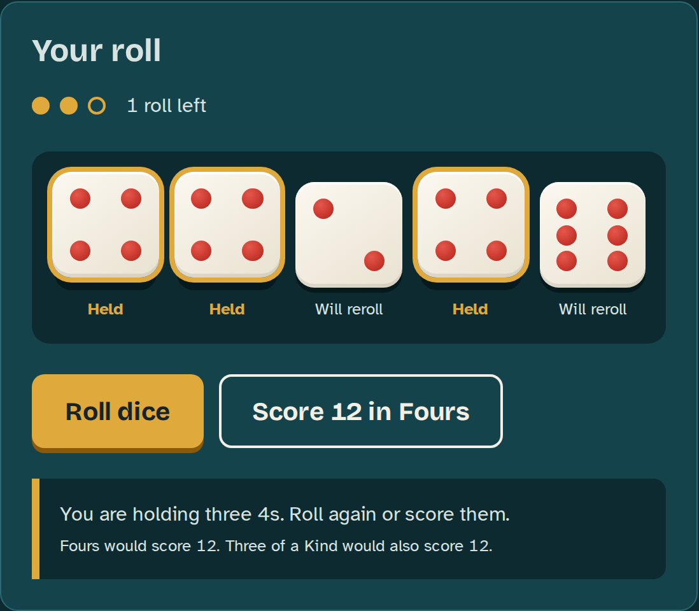

# Yatzy Game

This is an implementation of the dice game **Yatzy** (also known as Yahtzee) in a browser-based environment. Players roll five dice up to three times per turn and decide which to keep and fill a scoreboard with the best combinations they can

## 1. Rules
1. Roll all five dice 
2. Hold the dice you want to keep and held dice stay put 
3. Reroll the rest. You can reroll up to two more times
4. Score the dice in one empty category. You have to pick one every turn. If nothing fits enter a 0 in the category you can afford to lose
5. The next round starts. When all 15 categories are filled, the game ends and the total is shown

The goal is the player with the highest total wins. However, in this single player version you play against your own best score

### Scoring 
the scorecard has two sections. Each category can be scored once per game 

**Upper section**:
- **Ones**: Sum of all dice showing 1
- **Twos**: Sum of all dice showing 2
- **Threes**: Sum of all dice showing 3
- **Fours**: Sum of all dice showing 4
- **Fives**: Sum of all dice showing 5
- **Sixes**: Sum of all dice showing 6
- **Bonus**: if your score is 63 or more in the upper section you get 50 bonus points 

**Lower section**:
- **One pair**: you need two dice with the same number and the score is the sum of those 2 dice
- **Two pairs**: you need two different pairs and the score is the sum of the four dice in the pairs
- **Three of a kind**: you need three dice with the same number and the score is the sum of those three dice 
- **Four of a kind**: you need four dice with the same number and the score is the sum of those four dice 
- **Small Straight**: you need 1-2-3-4-5 and the score is 15 points  
- **Large Straight**: you need 2-3-4-5-6 and the score is 20 points 
- **Full House**: you need three of one number plus a pair of another and the score is the sum of all five dice 
- **Chance**: you need anything and the score is the sum of all five dice 
- **Yatzy**: you need all five dice to be the same and the score is 50 points 

### End of the game
- the game ends after the 15th category is scored 
- the end screen shows the upper total, bonus, lower section and final score

### languages used
- HTML
- CSS
- JavaScript (used for actual implementation)

## 2. Yatzy Design System

This document outlines the colours, fonts and other necessary designs for the Yatzy game 

### Colour Palette

The colour palette has a very similar look for the table as you would see in other dice games however slightly different to give it its own look, the dice colours give a classic look however make them stand out. The brass is mainly just aesthetic choice to work with everything else. The scorecard gives a paper feel as it would in the real game

#### 1.1 Primary Colours
| Name | | Hex | | Usage |
| --- |  --- |  --- |
| **Lagoon 900** | `#0C2A30` | Page background, dice tray |
| **Lagoon 700** | `#14434B` | Panels such as the game board |
| **Bone** | `#F4EFE4` | Dice faces, scorecard paper |
| **Pip Red** | `#C8372D` | Dice pips, zero scores |

#### 1.2 Secondary Colours
| Name | Hex | Usage |
| --- | --- |  --- |
| **Brass** | `#E0A93B` | Main buttons, held dice, selected category, lower section accent |
| **Lagoon 500** | `#2A6A73` | Borders, upper section accent|
| **Mist** | `#D7E3E1` | Body text on dark backgrounds |
| **Ink** | `#162428` | Body text on paper and on brass |

#### 1.3 Tints
| Name | Hex | Usage |
| --- | --- | --- |
| **Bone Shade** | `#E3DCCB` | Row dividers on the scoreboard |
| **Ink soft** | `#4F6165` | Secondary text on paper
| **Brass Deep** | `#8A5A0B` | Brass when used as text or a thin line on paper, button shadow |

### Typography

The headings are using chunky letterforms to have a playful feel while still suiting a dice game. While the body text uses a font that makes it easy to tell letters and numbers apart which matter in a scorecard full of numbers 

- **Headings and subheadings**: `"Bricolage Grotesque", "Trebuchet MS", system-ui, sans-serif`
- **Body text, labels, scores**: `"Atkinson Hyperlegible", "Segoe UI", system-ui, sans-serif`

## 3. Yatzy Dice Design 

### size and shape
- each die is **88 px** on a desktop and shrinks to **56 px** on a phone 
- the shape is a rounded square

### Colour and Texture
- the colour of the die is a white with a soft diagonal gradient 
- the edge has a light top highlight, a bottom shade and a 4 px dark shadow underneath

### Pips
- the colour of the pips is a bright red with a small highlight so each pip has a dimple look to it
- each die is 3x3 grid with the styling of what a regular die would look like 

### states
| State | Look |
| --- | --- |
| Not rolled yet | plain die, no pips, not pressable |
| Resting | full colour face, solid 4px shadow |
| Hover | lifts 3 px |
| Held | lifts 8px, 4 px brass ring "Held" label underneath  |
| Rolling  | tumbles for 0.6 s up and down with small rotations |
| Disabled | faded, not pressable |

## 4. Game Mockups 

the mockups are built in HTML/CSS (`mockup.html` + `mockup.css`) using the colour palette and fonts outlined. the code is commented to explain what each section is 

### Game Screen (Desktop)

### Game Board

### Scorecard

### Game over screen

### Mobile 

## 5. Layout, Game Flow, Animations

## Layout
- **Header**: has game title, under the round counter and in the right corner the total score 
- **board**: has a roll counter and under the roll counter all of the dice, and under a button to roll dice and a button next to it on the right to score whatever score the player has, all under that an explanation to what you have and possible scoring options
- **scorecard**: there is a header above to split the scorecard into 3 sections category, how it scores and score, then the upper section table is listed with the lower section table under it, then at the bottom of the scorecard the total score 

## game flow 
## 1. How the game works
1. The player presses the **Roll dice**, the game rolls all five dice and the roll counter tells the player they have used one roll
2. The player presses dice to **hold them** the game marks those dice as held
3. The player presses **Roll dice**, the game rerolls the dice that are not held, again the roll counter tells the player now they have used 2 rolls
4. **Optional** the player holds or releases the dice again, the game updates the held list
5. **Optional** the player presses **Roll dice** one last time, the game rerolls the unheld dice and the roll counter tells the player they have used 3 rolls 
6. The player selects a category on the scorecard, the game then calculates the score for that category 
7. The player presses the **Score whatever number is displayed in Category** (example **Score 12 in Category**)
8. The game moves to the next round 

## Animations planned 
the animations planned will be the dice tumbles for 0.6 s up and down with small rotations