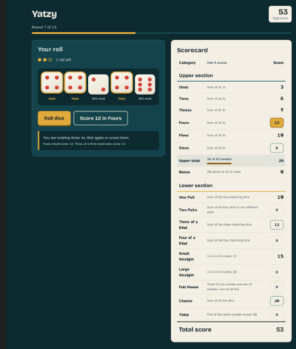
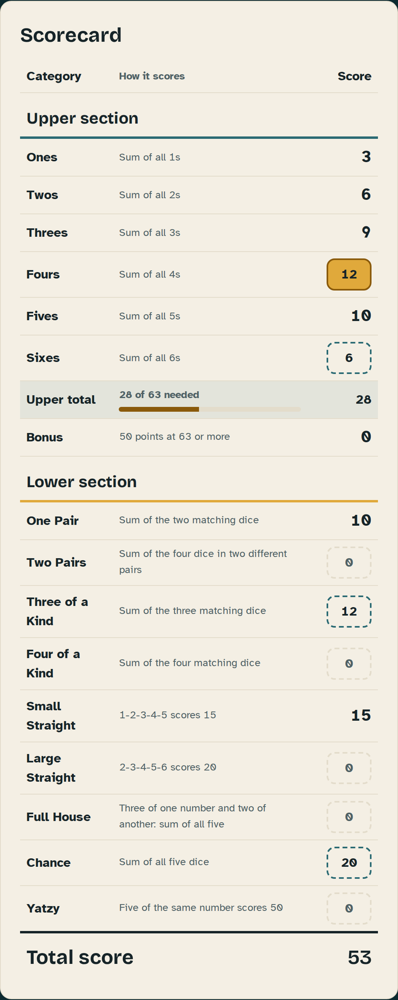
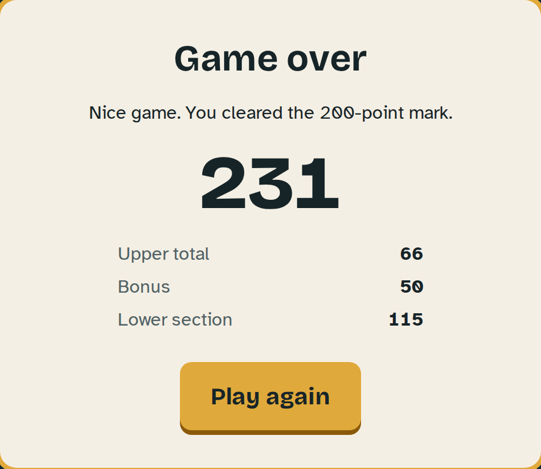
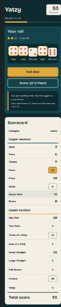

# Yatzy Design System

This document outlines the colours, fonts and other necessary designs for the Yatzy game 

## 1. Colour Palette

The colour palette has a very similar look for the table as you would see in other dice games however slightly different to give it its own look, the dice colours give a classic look however make them stand out. The brass is mainly just asethetic choice to work with everything else. The scorecard gives a paper feel as it would in the real game

# **1.1 Primary Colours**
- **Lagoon 900**: `#0C2A30` |Page background, dice tray|
- **Lagoon 700**: `#14434B` |Panels such as the game board|
- **Bone**: `#F4EFE4` |Dice faces, scorecard paper|
- **Pip Red**: `#C8372D` |Dice pips, zero scores|

# **1.2 Secondary Colours**
- **Brass**: `#E0A93B` |Main buttons, held dice, selected category, lower section accent|
- **Lagoon 500**: `#2A6A73` |Borders, upper section accent|
- **Mist**: `#D7E3E1` |Body text on dark backgrounds|
- **Ink**: `#162428` |Body text on paper and on brass|

# **1.3 Tints**
- **Bone Shade**: `#E3DCCB` |Row dividers on the scoreboard|
- **Ink soft**: `#4F6165` |Secondary text on paper|
- **Brass Deep**: `#8A5A0B` |Brass when used as text or a thin line on paper, button shadow|

## 2. Typography

The headings are using a chunky letterforms to have a playful feel while still suiting a dice game. While the body text uses a font that makes it easy to tell letters and numbers apart which matter in a scorecard full of numbers 

- **Headings and subbheadings**: `"Bricolage Grotesque", "Trebuchet MS", system-ui, sans-serif
- **Body text, labels, scores**: `"Atkinson Hyperlegible", "Segoe UI", system-ui, sans-serif

## 3. Game Mockups 

the mockups are built in HTML/CSS (`mockup.html` + `mockup.css`) using the colour palette and fonts outlined. the code is commented to explain what each section is 

# Game Board (Desktop)

# Scorecard

# Game over screen

# Mobile 

## 4. Layout
- **Header**: has game title, under the round counter and in the right corner the total score 
- **board**: has a roll counter and under the roll counter all of the dice, and under a button to roll dice and a button next to it on the right to score whatever score the player has, all under that an explanation to what you have and possible scoring options
- **scorecard**: there is a header above to split the scorecard into 3 sections category, how it scores and score, then the upper section table is listed with the lower section table under it, then at the bottom of the scorecard the total score 
