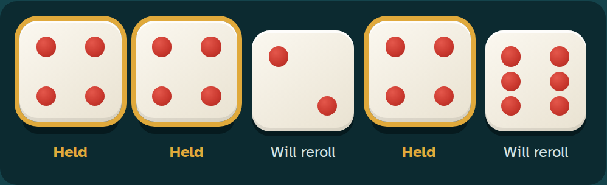

# Yatzy Dice Design 

# size and shape
- each die is **88 px** on a desktop and shrinks to **56 px** on a phone 
- the shape is a rounded square

# Colour and Texture
- the colour of the die is a white with a soft diagonal gradient 
- the edge has a light top highlight, a bottom shade and a 4 px dark shadow underneath

# Pips
- the colour of the pips is a bright red with a small highlight so each pip has a dimple look to it
- each die is 3x3 grid with the styling of what a regular die would look like 

# states
| state | | Look |
| --- | | --- |
| Not rolled yet | | plain die, no pips, not pressable |
| Resting | | full colour face, solid 4px shadow |
| Hover | | lifts 3 px  |
| Held | | lifts 8px, 4 px brass ring "Held" label underneath  |
| Rolling  | | tumbles for 0.6 s up and down with small rotations  |
| Disabled | | faded, not pressable |

